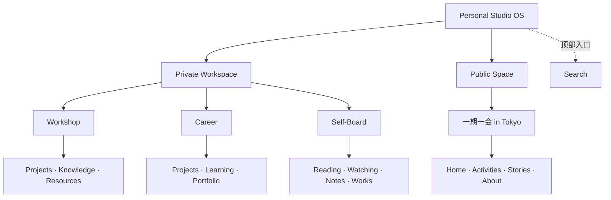

# Personal Studio OS 信息架构

首页按访问边界分为 Private Workspace 与 Public Space。第一层是三个私人空间及一个公开品牌，第二层是各自的集合或品牌页面。空间概览负责指引；集合页有独立地址与说明性空状态。

| 空间 | Overview | 第二层 |
|---|---|---|
| Workshop | `/#/workshop` | `projects`、`knowledge`、`resources` |
| Career | `/#/career` | `projects`、`learning`、`portfolio` |
| Self-Board | `/#/self-board` | `reading`、`watching`、`notes`、`works` |
| 一期一会 in Tokyo | `/#/public/yiqiyihui` | Home 使用品牌根地址，其他页面使用 `activities`、`stories`、`about` |

面包屑连接首页、空间和集合，浏览器返回与刷新使用 Hash Router。旧链接中仍有对应页面的 `#/private/…` 与 `#/public/tokyo/…` 继续可用。已移除的集合和虚构记录详情显示找不到页面，并提供返回入口。

Search 是顶栏全局入口，当前在空的私人内容 Repository 上查询，未来接入统一索引。Inbox / Capture 预留为全局能力，当前没有入口按钮。Connections 的双向查询留在 Repository。Creation 和 Publication Status 的独立页面已移除，未来分别从空间与内容内操作。Registration 预留为未来 Activities 详情操作。

## 数据与扩展边界

`content`、`relations`、`activities`、`stories` 都是空集合。上一版的示例内容和依赖示例 ID 的详情、筛选、关系演示与报名预览已移除。代码历史保留，可从此前提交查看。

`studioRepository.list()`、`get()`、`related()` 保留现有查询形式。公开的 `publicRepository.activities()` 和 `stories()` 保留独立读取边界。Content 仍可区分 input/output、归属领域、创作阶段及可见性；Relation 仍保存来源、目标与标签。未来公开内容从已确认字段生成独立投影。

这个公开仓库的 Demo 仅呈现信息架构。Private Workspace 是产品区域名称，真实私人数据的身份验证与授权在未来服务端实现。
