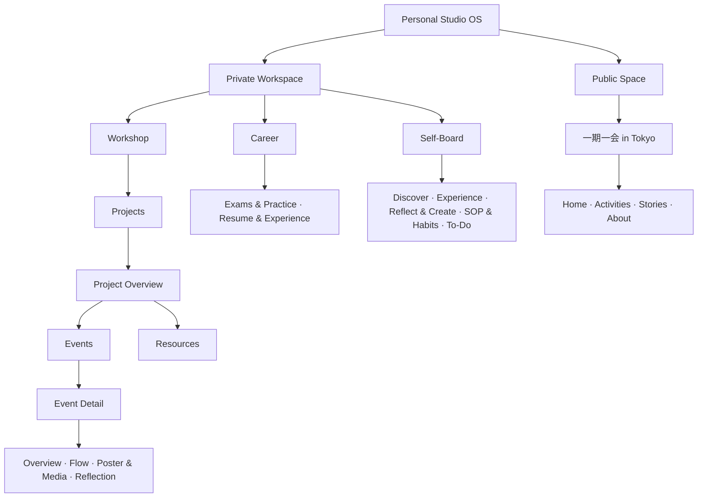

# Personal Studio OS 信息架构

首页分为 Private Workspace 和 Public Space。私人空间包含 Workshop、Career、Self-Board。公开品牌为「一期一会 in Tokyo」。每个私人空间有独立概览，顶栏保留全局 Search。

| 空间 | Overview | 集合或品牌页面 |
|---|---|---|
| Workshop | `/#/workshop` | Projects。进入 Project 后可打开 Events 与 Resources。 |
| Career | `/#/career` | Exams & Practice、Resume & Experience |
| Self-Board | `/#/self-board` | Discover、Experience、Reflect & Create、SOP & Habits、To-Do |
| 一期一会 in Tokyo | `/#/public/yiqiyihui` | Home、Activities、Stories、About |

## Workshop

Project 是可反复举办、长期演进的活动形式或系列。每个 Project 可以包含多个主题不同的 Event。Project Overview 提供并列的 Events 与 Resources。Event 的基本信息、流程、海报与媒体、复盘各有独立板块。旧的 Workspace 级 Sessions 或 References 地址可以返回 Workshop 概览。

| 页面 | 结构预览路径 |
|---|---|
| Projects | `/#/workshop/projects` |
| Project Overview | `/#/workshop/projects/preview` |
| Events | `/#/workshop/projects/preview/events` |
| Event Detail | `/#/workshop/projects/preview/events/preview` |
| Resources | `/#/workshop/projects/preview/resources` |

`preview` 是专供结构展示的路由段，业务集合仍为空。所有页面可刷新、直达，通过浏览器返回或面包屑回到上一级。未知 Project、Event 或板块提供返回最近有效上级的入口。

Resources 支持项目专属素材和对 Discover 原始内容的引用。资源模块由 `site/pages.js` 的有序配置驱动。Guiding Questions、Cards、Goals & Expected Outcomes、References 是可替换的默认配置。项目可提供自己的 `resourceModules`，包括空列表。未来可通过调整模块配置新增、删除、重命名和排序，显示名称与稳定模块 ID 分开保存。

## Self-Board

Discover、Experience、Reflect & Create 是内容视图，SOP & Habits、To-Do 是行动视图，五个入口在同一层。一个内容可以出现在多个内容视图，也可以有多个主题和关联领域。

| 入口 | 用途 |
|---|---|
| Discover | 阅读、课程、收藏、知识与参考素材 |
| Experience | 旅行、美食、影视、展览与日常体验 |
| Reflect & Create | 日记、随笔、思考、文章与创作 |
| SOP & Habits | SOP 保存可重复使用的流程步骤。Habit 保存有频率的行为。 |
| To-Do | 一次性任务和计划。后续可与 SOP、Habit 或其他内容建立关联。 |

## 接入真实数据

1. 由受控云端 API 实现 Repository 的查询边界。Project、Event、ProjectResource 各有独立 ID，按 Project 查询 Events 和 Resources。预览路由标识保留给原型，业务记录使用服务端分配的 ID。SOP、Habit、To-Do 分别定义模型。
2. 资源模块保存稳定 ID、名称和顺序。项目引用通用知识时保存 `sourceContentId`。一个原始内容可被多个项目引用。移除模块前先处理它的资源归属。
3. 为每个 Event 保留独立记录和历史。实际采用的资源保存资源 ID 与不可变版本 ID，或者保存当时的快照，以便回看。Event 的公开海报或内容未来可通过独立公开投影关联到「一期一会 in Tokyo」。
4. 保留内容类型、标签、关联、可见性和状态的独立维度。私人接口由服务端验证身份，公开页面只读取批准后的投影。真实数据接入前先验证项目隔离、引用权限和历史版本回放。

当前 Demo 使用空集合与静态页面配置。保留 Search、Repository 双向关联与未来 Inbox / Capture 的扩展位置。
