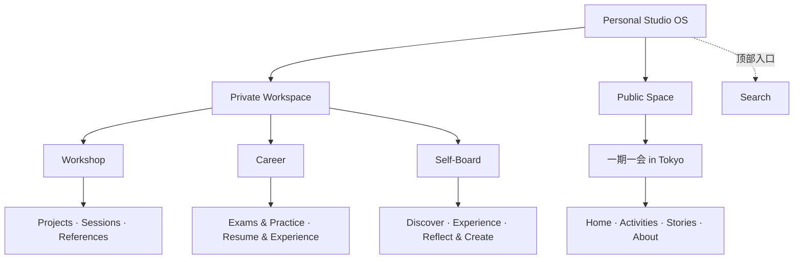

# Personal Studio OS 信息架构

首页按访问边界分为 Private Workspace 与 Public Space。第一层是三个私人空间及一个公开品牌，第二层是各自的集合或品牌页面。Workspace Overview 说明空间用途，集合页有独立地址与说明性空状态。

| 空间 | Overview | 第二层路径 |
|---|---|---|
| Workshop | `/#/workshop` | `projects`、`sessions`、`references` |
| Career | `/#/career` | `exams-practice`、`resume-experience` |
| Self-Board | `/#/self-board` | `discover`、`experience`、`reflect-create` |
| 一期一会 in Tokyo | `/#/public/yiqiyihui` | Home 使用品牌根地址，其他页面使用 `activities`、`stories`、`about` |

- **Workshop** 管理线下活动的主题、企划、流程、主持稿和实践复盘。未来一个 Project 可关联多个 Sessions。References 展示项目与资料之间的关系，原始资料保存在 Self-Board 的 Discover，一份原始资料可以被多个项目引用。
- **Career** 记录职业发展。Exams & Practice 将接入独立题库，考试记录留在职业学习场景。Resume & Experience 汇总简历、工作项目、专业技能与经历。知识或经验未来可按需关联到其他领域。
- **Self-Board** 为个人兴趣、生活体验和创作提供三个可重叠的视图。Discover 包含阅读、课程、卡牌、心理学理论和网络收藏。Experience 记录旅行、美食、影视、展览与日常探索。Reflect & Create 用于日记、随笔、思考、观后感和个人作品。一个内容可以出现在多个视图，新增主题可使用标签或自定义视图。

面包屑连接 Home → Workspace → Collection，Hash Router 保留返回、刷新与直接访问。未来详情沿用 `/#/<workspace>/<collection>/<id>`。空白 Demo 中没有记录可打开，访问不存在的详情会给出返回集合的入口。旧的第二层入口已退役，访问其地址可返回对应空间。

Search 保留在顶栏。Inbox / Capture 预留为未来统一收集能力。Connections 目前只保留 Repository 的双向查询。创作、发布与报名预留在相应内容或活动详情中。

## 数据与扩展边界

`content`、`relations`、`activities`、`stories` 都是空集合。保留 `studioRepository.list()`、`get()`、`related()`，以及独立的公开读取接口 `publicRepository.activities()` 和 `stories()`。当前为只读 Demo，未来可由受控云端 API 提供数据。

| 维度 | 用途 |
|---|---|
| Workspace | 可选主归属与多个关联领域。保留既有的 `domains` 关联字段。 |
| Content Type | 资料、体验、笔记、作品等内容类型。 |
| Tags | 可增删的多个主题，例如旅行、美食、卡牌或心理学。 |
| Relations | 保存内容之间的来源、目标与标签，例如项目引用资料。 |
| Visibility | 内容是否私人或公开。公开页面读取独立的公开投影。 |
| Status | 草稿、进行中、完成等创作状态。 |

输入与输出是记录属性。Self-Board 的三个入口是导航视图，可在这些维度上组合查询。真实数据的身份校验和授权由未来服务端负责。
