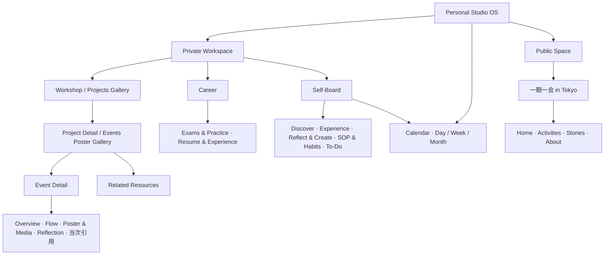

# Personal Studio OS 信息架构

首页分为 Private Workspace 和 Public Space。私人空间包含 Workshop、Career、Self-Board。公开品牌为「一期一会 in Tokyo」。每个私人空间有独立概览，顶栏保留全局 Search。

| 空间 | Overview | 集合或品牌页面 |
|---|---|---|
| Workshop | `/#/workshop` | Projects。进入 Project 后可打开 Events 与 Resources。 |
| Career | `/#/career` | Exams & Practice、Resume & Experience |
| Self-Board | `/#/self-board` | Self-Board Overview 使用独立 Widget。Discover 用缩略卡片，Experience 用视觉 Gallery，Reflect & Create 用标题和摘要。具体内容可通过 `views` 出现在多个布局中，维持稳定的内容 ID。

SOP 和 Habit 有各自的执行页面。SOP 显示可推进和回退的步骤。Habit Focus 展示今日打卡和最近七天记录。To-Do 在本周和本月之间切换，可直达 Calendar。

## Calendar 与会话数据

`/#/calendar?view=week&date=YYYY-MM-DD` 可直接打开指定日期和视图。Calendar 的 Day、Week、Month 共用同一份日期状态。点击周历或月历的日期会更新当天事项。点击待办可修改标题、日期与完成状态。

Calendar 和 To-Do 共用 `plannerRepository`。Habit Focus 写入的打卡日期也从这里读取。当前 Repository 使用页面内存，路由切换时数据保留，刷新或开启新标签页会使用新的空会话。项目、活动、原始内容和资源集合保持为空。

## 接入真实数据

1. 由受控云端 API 实现 Repository 的查询边界。Project、Event、ProjectResource 各有独立 ID，按 Project 查询 Events 和 Resources。预览路由标识保留给原型，业务记录使用服务端分配的 ID。SOP、Habit、To-Do 分别定义模型。
2. 资源模块保存稳定 ID、名称和顺序。项目引用通用知识时保存 `sourceContentId`。一个原始内容可被多个项目引用。移除模块前先处理它的资源归属。
3. 为每个 Event 保留独立记录和历史。实际采用的资源保存资源 ID 与不可变版本 ID，或者保存当时的快照，以便回看。Event 的公开海报或内容未来可通过独立公开投影关联到「一期一会 in Tokyo」。
4. 保留内容类型、标签、关联、可见性和状态的独立维度。私人接口由服务端验证身份，公开页面只读取批准后的投影。真实数据接入前先验证项目隔离、引用权限和历史版本回放。

Calendar 持久化接入时，将待办与打卡替换为同一受控 API，保留现有日期筛选和编辑入口。服务端按用户授权读写，处理时区、并发编辑和版本冲突。
