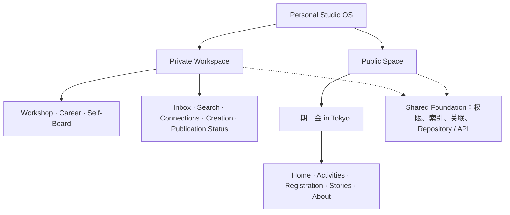
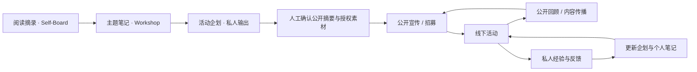

# Personal Studio OS 信息架构

个人知识从收集开始，跨领域组织和关联，形成作品或活动。创作成果可以继续留在私人空间。只有经过单独确认的字段与媒体进入公开空间，公开活动产生的反馈再回到私人积累。

## Sitemap

| 第一层 | 第二层 | 页面定位 |
|---|---|---|
| Private Workspace | Home | 继续最近工作、找回项目与创作、处理待整理内容 |
| Private Workspace | Workshop | 活动企划、卡牌 Wiki、方法、带领、素材与复盘的入口 |
| Private Workspace | Career | 职业经验、技能、作品、资格与练习的入口 |
| Private Workspace | Self-Board | Reading、Watching、Notes、Thoughts、Inspirations、Journals、Creative Works |
| Private Workspace | Inbox / Capture、Search | 收集队列与跨领域检索，放在顶部快捷区 |
| Private Workspace | Connections | 按节点追踪原始输入、跨领域关联、输出及反馈 |
| Private Workspace | Creation、Publication Status | 查看输出及独立的创作状态、可见性 |
| Public Space · 一期一会 in Tokyo | Home | 品牌主页、活动与 Stories 入口 |
| Public Space · 一期一会 in Tokyo | Activities、Registration | 活动筛选与活动介绍、报名示意 |
| Public Space · 一期一会 in Tokyo | Stories、About | 活动回顾、文章和品牌介绍，附两个循环演示 |

把两组页面放在同一条侧栏，切换快，也适合少量平级页面。品牌或私人领域一多，导航容易拥挤，公开端也难形成完整的网站体验。Demo 采用顶部空间切换器，私人区用工作侧栏，公开区用品牌站导航。全局检索、收集入口放在私人快捷区。将来新增私人领域、公开页面或品牌时，先新增页面注册项及其渲染函数。Shared Foundation 不占顶层导航。

## 内容流动与公开运营

Repository 的私有查询和公开投影各自有边界。Demo 使用分开的只读示例集合，仅在当前页面保留临时交互状态。真正的私有页面应在身份验证之后由 Worker 提供。公开 API 只返回已经批准的发布投影。当前 Demo 内的 “Private” 是页面概念，数据都是示例。

建议的实体有 Content、Relation、Publication、Asset 和 Feedback。Content 独立记录 input/output、结构化/碎片化、创作阶段、可见性及多个领域。Relation 用来源、目标和关系类型连起来。Publication 保存已批准的字段、媒体授权及渠道信息，不直接暴露原 Content。Asset 在私有 R2 中使用对象键，公开文件通过授权后的副本提供。参与者个人信息、照片及分享默认留在内部。
